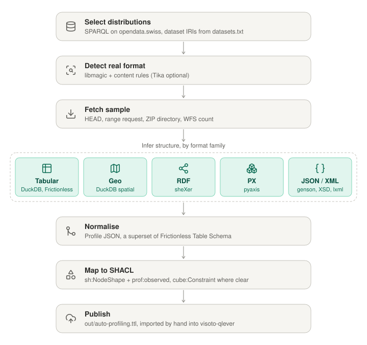

# auto-profiling

Auto-detected structures (SHACL + profiles) for opendata.swiss distributions.

| File | Intent |
|---|---|
| [architecture.md](architecture.md) | Summary of the design discussion, flowchart, tool choices |
| [01-purpose.md](01-purpose.md) | Goal, input, output, scope, how it fits the repo |
| [02-model.md](02-model.md) | Output RDF model, IRIs, type mapping, cube rules |
| [03-plan.md](03-plan.md) | Implementation phases with tasks and done criteria |
| [open-questions.md](open-questions.md) | Not yet decided |
| [prototype/](prototype/) | 2026-11-03 prototypes: tabular inference and Table Schema → SHACL/cube mapper, with sample input and output |

Started 2026-11-03.
