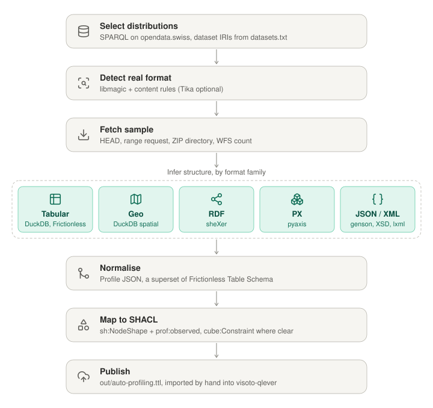

# Architecture

Summary of the design discussion of 2026-11-03 that led to this pipeline.
Details are in [01-purpose.md](01-purpose.md), [02-model.md](02-model.md) and
[03-plan.md](03-plan.md).

Icons: [Lucide](https://lucide.dev) v0.460.0 (ISC licence). The SVG is
generated by [prototype/build_pipeline_svg.py](prototype/build_pipeline_svg.py).

## Starting point: what is on opendata.swiss?

All `dcat:Distribution` on the ODS ABN endpoint were analysed with the visoto
MCP server: 84,999 distributions in 17,384 datasets.

**Format metadata is unreliable:**
- 15% of distributions have neither `dct:format` nor `dcat:mediaType`, and
  another 3,953 are `UNSPECIFIED`.
- `dct:format` mixes EU file-type IRIs, the same IRIs as string literals, and
  free text such as `"CSV"`, `"gpkg"` and `"WMS"`.
- `dcat:mediaType` mixes literals with `http`- and `https`-style IANA IRIs,
  and includes non-standard values such as `application/xls`.
- 62% of URLs have no file extension, and many apparent extensions are
  artefacts (`.01`, `.ch`, `.aspx`).

The pipeline therefore never trusts declared formats alone. It combines
three signals (format, media type, extension) and confirms them by sniffing
the content.

**Which formats can carry a structure:**

| Category | Formats | Share |
|---|---|---|
| Describable | CSV, XLSX, XLS, ODS, Parquet, JSON, XML, INTERLIS, RDF serialisations, GPKG, SHP, GeoJSON, GML, NetCDF, WFS, SPARQL | ~38% |
| Conditional | ZIP containers, REST APIs, TIFF, KML, GPX, TXT | ~13% |
| Not describable | HTML, PDF, WMS/WMTS, images, documents | ~31% |
| Unknown | — | ~18% |

**Selected for this pipeline:** CSV, XLSX, JSON, SHP, WFS, Parquet, XLS, GPKG,
PX, RDF (JSON-LD, Turtle, N3, RDF/XML), GML, ODS and XML. The selection query
matches about 35,500 distributions. GeoJSON and SPARQL endpoints were left
out for now.

The same analysis on data.europa.eu (6.1M distributions) showed the same
picture at larger scale: CSV first, WMS and WFS next, and many unnormalised
format literals. In SPARQL endpoints listed on opendata.swiss, LINDAS prod
dominates. Integration and internal cluster URLs (`int.lindas`,
`lindas-cached.int…`) also appear in production metadata and should be
cleaned up at the source.

## Tool choices

| Need | Chosen | Considered | Why |
|---|---|---|---|
| Format detection | libmagic + content rules | Apache Tika, Magika | No JVM; the rules cover what magic numbers can't (CSV, PX, JSON-LD, GML, Opendatasoft exports, HTML error pages) |
| Tabular inference | DuckDB + Frictionless | Frictionless alone, ydata-profiling, csvkit | Frictionless gives Table Schema output but no per-field statistics, and misses `dd.mm.yyyy` dates; DuckDB's `sniff_csv` and `SUMMARIZE` fill both gaps |
| Geo | DuckDB `spatial` (bundled GDAL) | `ogrinfo` / pyogrio | One engine for tabular and geo; pyogrio is the fallback |
| PX | pyaxis, PxWeb metadata API | — | The only maintained parser; PX maps almost one to one onto `cube:Constraint` |
| RDF | sheXer | QSE (Java) | Python, emits SHACL with support ratios |
| JSON / XML | genson, XSD, lxml path statistics | Trang | No ready-made profiler for XML value distributions exists |
| Catalogue UI | visoto (SHACL in QLever) | OpenMetadata, DataHub, SchemaSpy | Those need S3-style storage and cover only tabular formats; visoto already renders SHACL |

DuckDB is an in-process library: a 24 MB wheel, about 67 MB installed, no
dependencies. Extensions load on demand; `spatial` is the largest. Memory use
measured about 32 MB after import and a 170 MB peak when summarising an 82 MB
CSV. It spills to disk above `memory_limit`, so 512 MB per worker is enough
for sample-sized input.

## Key design decisions

- **Sample, don't download.** HEAD plus range requests, Parquet footers, ZIP
  central directories, and WFS `count`. Results are cached by ETag or
  Last-Modified.
- **One structure per equivalent export group.** Opendatasoft publishes one
  table in about 8 formats; it is profiled once, and every distribution points
  to the same structure via `dct:conformsTo`.
- **Structure and profile are kept apart.** SHACL constraints are stable;
  observed statistics (`prof:observed`) change per run and never become
  constraints.
- **Aligned with I14Y:** `dct:conformsTo` → structure → `dct:hasPart` →
  `sh:NodeShape`, the same pattern as the I14Y structures the `i14y`
  pipeline already loads, so visoto templates serve both.
- **`cube:Constraint`** is produced for PX always, and for tables only when
  the key dimensions uniquely identify rows and there is a numeric measure.
- **The base IRI is configurable** (`BASE_IRI`); identifiers are hashes of the
  representative distribution IRI, so reruns are stable.
- **Failures are data.** Skipped and failed distributions get a
  `prof:status` and reason, so visoto can explain why something has no
  structure.

## Prototype results

[prototype/](prototype/) holds the scripts written during the discussion. They
were tested on a generated CSV in typical opendata.swiss style: semicolon,
BOM, `dd.mm.yyyy` dates, `...` as the missing value.

- **`infer_tabular.py`:** Frictionless plus DuckDB. It detected the dialect,
  types (with the date fix), null percentages, quartiles, code lists, and
  categorical and boolean hints.
- **`tableschema_to_shacl.py`:** mapped that output to SHACL and
  `cube:Constraint` (`cube.ttl`). The sample rows, converted to
  `cube:Observation`s, conform under pyshacl.
